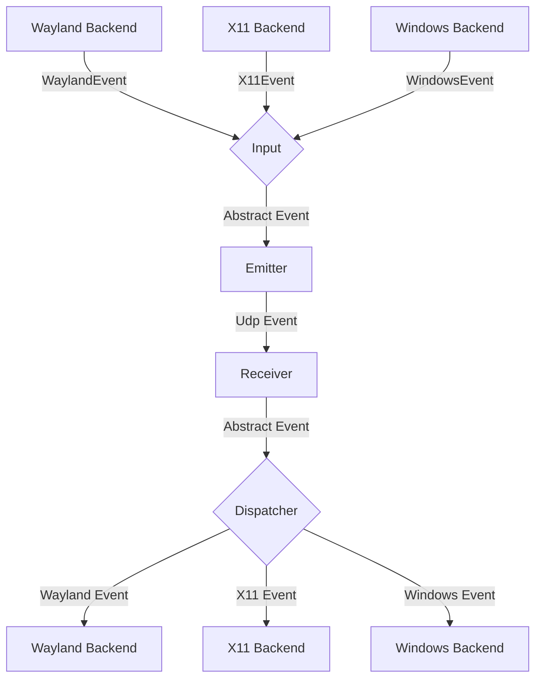
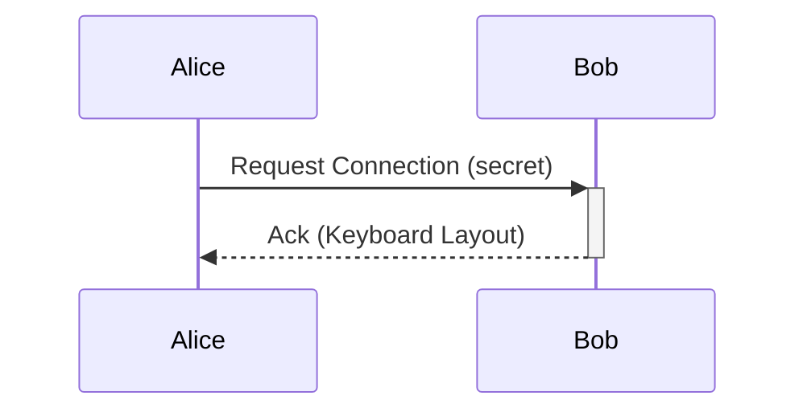

# General Software Architecture

## Input Emulation Session Recovery

If an established input-emulation stream closes, for example after a Wayland
desktop session is interrupted, the daemon cleans up the old backend and
attempts to create a new session after one second. An EIS socket reset, broken
pipe, or other closed-connection I/O error is treated as session termination,
just like an explicit disconnect or EOF. The libei backend can reuse its saved
RemoteDesktop restore token.

When supported, the libei backend uses the portal's session-state monitor to
wait for desktop unlock before opening a RemoteDesktop session. This avoids
requesting a replacement while the compositor still rejects remote access.
Monitoring does not inhibit screen locking. Portals without session monitoring
retain the existing creation behavior, with a warning.

Input received while recovery is pending is discarded rather than replayed.
Disconnected peers are removed before restoring client handles. Shutdown cancels
recovery, and manually enabling emulation can start it without waiting for the
delay.

Creation failures, rejected authorization, and other runtime errors still
require manually enabling Input Emulation; they do not trigger repeated
authorization requests. This does not change InputCapture authorization: the
version 1 portal can still require consent for a new capture session.

## Input Capture Session Recovery

The libei capture backend monitors the InputCapture portal's `Session.Closed`
signal. When an established session closes, it stops using that session and
unblocks any pending barrier updates. The daemon releases captured keys and
leaves the remote client before recreating the backend after one second.
Client removals and release-binding changes are preserved during recovery;
shutdown cancels the pending retry.

Removing a capture handle also discards its queued events. This prevents a
late event from referring to a removed client during peer disconnect or
recovery, while preserving queued events for other clients on the same edge.

Creation failures, rejected authorization, and unrelated runtime errors still
require manually enabling Input Capture. InputCapture portal version 1 cannot
persist permission, so a replacement session can still require user consent.

## Events

Each instance of lan-mouse can emit and receive events, where an event is either
a mouse or keyboard event for now.

The general Architecture is shown in the following flow chart:

### Input

The input component is responsible for translating inputs from a given backend
to a standardized format and passing them to the event emitter.

### Emitter

The event emitter serializes events and sends them over the network to the
correct client.

### Receiver

The receiver receives events over the network and deserializes them into the
standardized event format.

### Dispatcher

The dispatcher component takes events from the event receiver and passes them to
the correct backend corresponding to the type of client.

## Requests

// TODO this currently works differently

Aside from events, requests can be sent via a simple protocol. For this, a
simple tcp server is listening on the same port as the udp event receiver and
accepts requests for connecting to a device or to request the keymap of a
device.

## Problems

The general Idea is to have a bidirectional connection by default, meaning any
connected device can not only receive events but also send events back.

This way when connecting e.g. a PC to a Laptop, either device can be used to
control the other.

It needs to be ensured, that whenever a device is controlled the controlled
device does not transmit the events back to the original sender. Otherwise
events are multiplied and either one of the instances crashes.

To keep the implementation of input backends simple this needs to be handled on
the server level.

## Device State - Active and Inactive

To solve this problem, each device can be in exactly two states:

Either events are sent or received.

This ensures that

- a) Events can never result in a feedback loop.
- b) As soon as a virtual input enters another client, lan-mouse will stop
  receiving events, which ensures clients can only be controlled directly and
  not indirectly through other clients.
